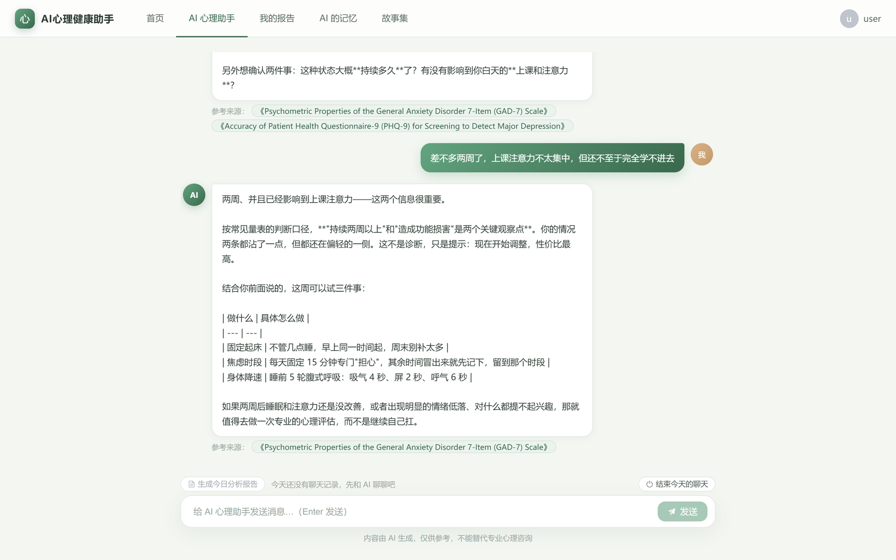
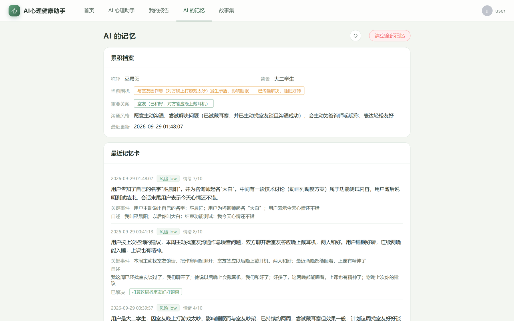
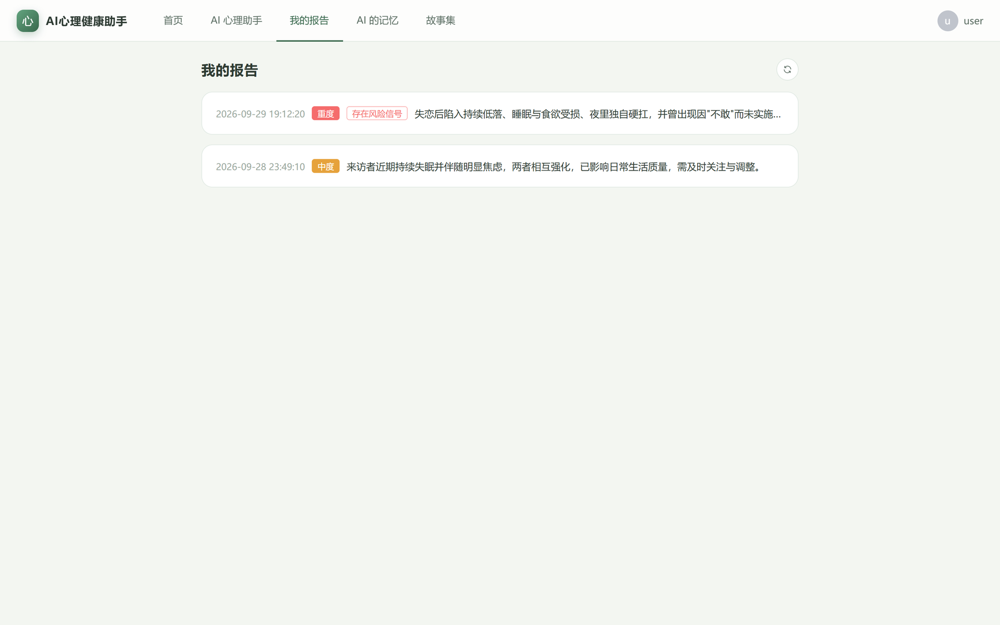
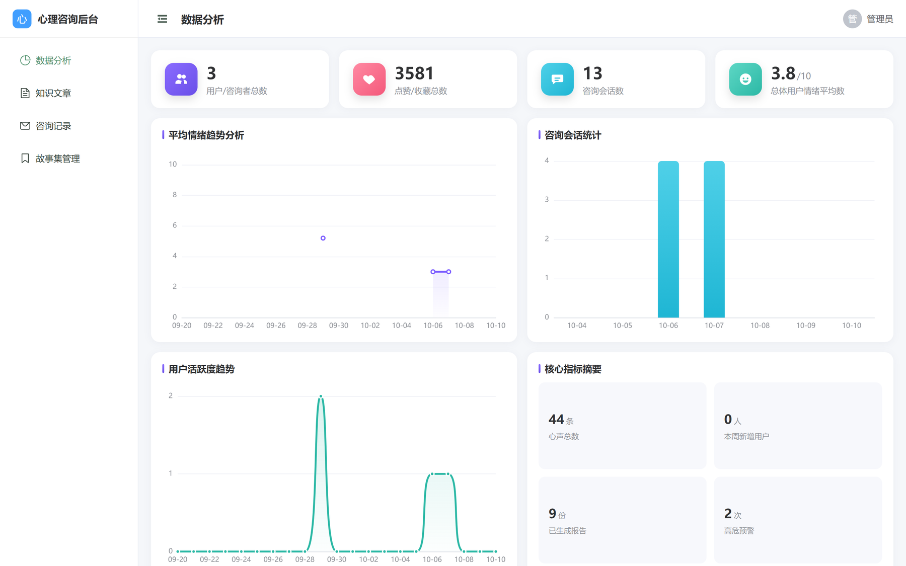
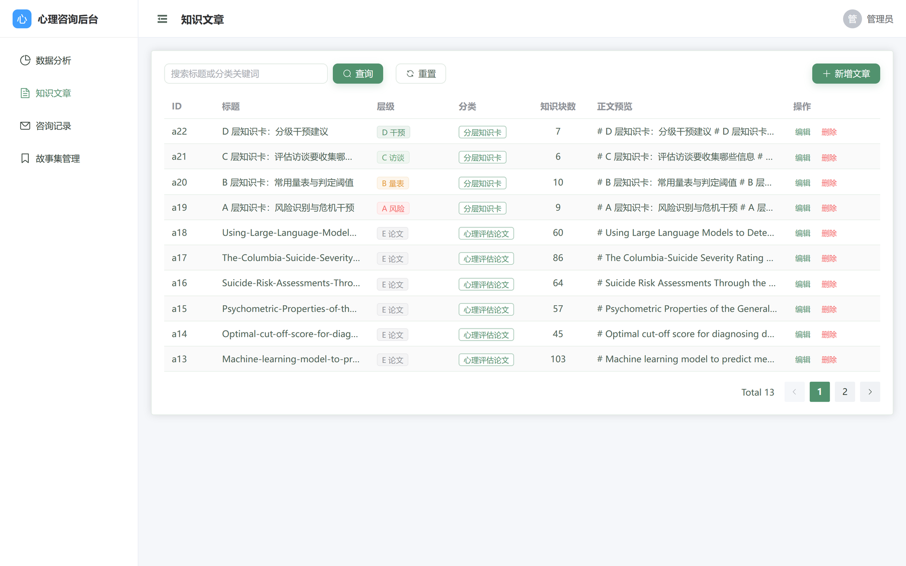
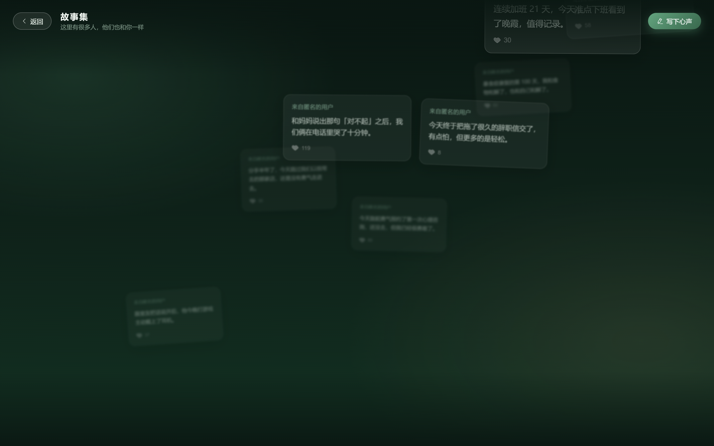
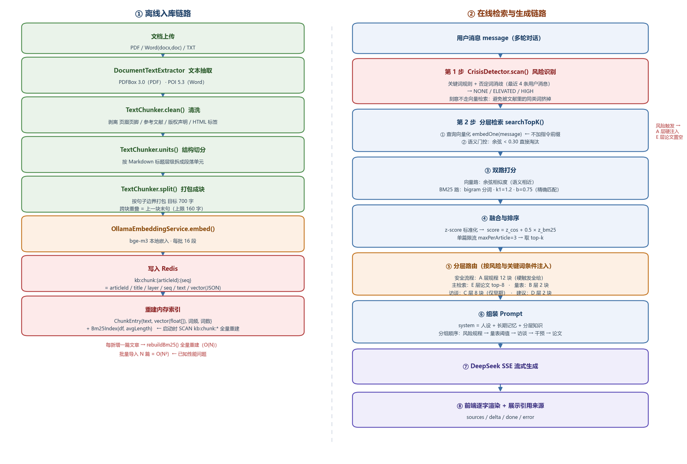

# 心语 PsychAI - AI 心理健康助手平台

<div align="center">


**AI 心理助手 · 长期记忆 · 咨询报告 · 风险识别 · 流式对话 全流程闭环**

[功能特性](#-功能特性) • [界面预览](#-界面预览) • [技术架构](#-技术架构) • [核心概念](#-核心概念) • [快速开始](#-快速开始) • [项目结构](#-项目结构) • [已知局限](#-已知局限)

</div>

> 🚀 **RAG + Function Calling 心理健康 AI 应用**：自研 **BM25 + 向量混合检索**（z-score 加权融合 / 相似度门控 / 单篇限流），按句子边界的文档切块与参考文献剥离，**A–E 五层专业知识按需注入**，Function Calling **强制结构化输出**实现长期记忆与咨询报告，`SseEmitter` 流式对话（sources / delta / done / error 四类事件），风险分级由**关键词规则引擎**兜底而非依赖模型。全链路不使用 Spring AI / LangChain，检索、切块、融合排序与工具调用编排均为自研实现。**Docker Compose 一键拉起 Redis / Ollama / 后端 / 前端**，本地无需安装任何运行时。喜欢给个 ⭐ Star！

---

## 📋 项目简介

「心语」是一个面向心理健康场景的 AI 对话与分析平台。通过 **LLM、RAG（检索增强生成）与 Function Calling** 三大核心能力，围绕 **「对话 → 记忆 → 报告」** 三条主线实现从日常陪伴式对话、长期记忆沉淀到结构化咨询报告的完整闭环。

- **智能对话**：流式输出的 AI 心理助手，回答时检索并注入专业知识，同时标注引用来源
- **长期记忆**：每轮会话自动沉淀为记忆卡与用户档案（情绪分 / 关键事件 / 自述 / 未完结话题）
- **咨询报告**：信息完整度达标后才生成结构化报告，附风险分级与分级干预建议
- **专业知识库**：A–E 五层知识体系，支持 PDF / Word / TXT 上传解析入库
- **安全兜底**：风险信号由规则引擎强制标记，命中红线直接走危机干预流程
- **双端形态**：用户端（对话 / 记忆 / 报告 / 心声墙）+ 管理端（知识库 / 咨询记录 / 数据分析）
- **一键部署**：Docker Compose 编排 Redis / Ollama / 后端 / 前端，含模型拉取与服务健康检查

> ⚠️ 本项目为技术演示项目，**不构成任何医疗建议**。详见文末[免责声明](#-免责声明)。

---

## 📸 界面预览

| 页面 | 预览 |
| :--- | :---: |
| **AI 对话助手** |  |
| **AI 记忆档案** |  |
| **咨询报告** |  |
| **数据分析** |  |
| **知识库管理** |  |
| **心声墙** |  |

### RAG 检索链路

左侧为离线入库链路（文档解析 → 清洗 → 句子级切块 → 批量嵌入 → 双索引落库），右侧为在线检索与生成链路（混合检索 → 门控 → z-score 融合 → 单篇限流 → 注入 Prompt）。



---

## ✨ 功能特性

### 🎯 核心闭环

#### 1. AI 对话 (Chat)

- **流式输出**：基于 `SseEmitter` 逐字推送，含引用来源、增量文本、结束、错误四类事件
- **知识注入**：每轮对话自动检索专业文献片段（默认 top-k = 8）注入 Prompt
- **来源可溯**：回答下方展示引用的知识条目，可点击查看
- **多轮上下文**：维护会话历史，支持上下文一致性

#### 2. 长期记忆 (Memory)

- **结构化抽取**：会话结束后通过 Function Calling 强制模型调用 `capture_memory` 工具
- **记忆内容**：会话摘要、情绪分（1–10）、关键事件、用户自述、风险等级、档案更新项、未完结话题
- **档案累积**：用户档案随对话持续更新，状态变化替换旧条目
- **数据隔离**：全部记忆按 `userId` 隔离，`userId` 只能来自 token

#### 3. 咨询报告 (Report)

- **完整度闸门**：先评估六个维度（具体表现 / 持续时间 / 功能损害 / 触发因素 / 应对方式 / 社会支持）的完整度，未达标直接拒绝生成并回显缺失项
- **结构化输出**：强制工具调用生成结构化报告 JSON，直接落库
- **风险分级**：附风险等级与分级干预建议，风险项由规则引擎强制标记
- **历史留存**：报告按天生成并保留可回查

#### 4. 知识库管理 (Knowledge)

- **分层维护**：A–E 五层知识卡，A–D 层随服务启动自动入库，E 层文献按需上传
- **文档解析**：支持 PDF（PDFBox）、Word（POI，docx / doc）、TXT 文本抽取
- **智能切块**：按标题层级与句子边界切块，跨块末句重叠，入库前剥离参考文献与版权块
- **后台 CRUD**：管理端支持文章列表、搜索、新增、编辑、删除

#### 5. 心声墙 (Wall)

- **匿名分享**：用户发布心声并支持点赞互动
- **内容管理**：管理端可发布、编辑、下架内容

### 🖥️ 管理端

- **数据分析**：咨询量、情绪分布、风险等级分布（ECharts 可视化）
- **咨询记录**：按用户查看历史会话，高危用户优先提示
- **知识库 / 心声墙管理**：内容运营与审核

---

## 🧱 技术架构

### 系统架构图

```text
┌─────────────────────────────────────────────────────┐
│              Vue 3 客户端（用户端 / 管理端）           │
│         Vue Router · Element Plus · ECharts          │
└───────────────────────┬─────────────────────────────┘
                        │ REST API / SSE
┌───────────────────────▼─────────────────────────────┐
│                Spring Boot 3 服务端                  │
│                    (Java 17)                        │
├─────────────────────────────────────────────────────┤
│  Controller Layer                                   │
│  ├── Auth      ├── Chat        ├── Knowledge        │
│  ├── Memory    ├── Report      ├── Record           │
│  └── Stats     └── Wall                             │
├─────────────────────────────────────────────────────┤
│  Core Engines                                       │
│  ┌──────────────┐ ┌──────────────┐ ┌──────────────┐ │
│  │ RAG Engine   │ │ Agent Engine │ │ Guard Engine │ │
│  │ 混合检索+切块 │ │ Function Call│ │ 风险分级规则  │ │
│  └──────────────┘ └──────────────┘ └──────────────┘ │
│  ┌──────────────┐ ┌──────────────┐ ┌──────────────┐ │
│  │ Doc Engine   │ │ Memory Store │ │ Stream Hub   │ │
│  │ PDF/Word 解析 │ │ 记忆与档案    │ │ SSE 流式推送  │ │
│  └──────────────┘ └──────────────┘ └──────────────┘ │
├─────────────────────────────────────────────────────┤
│  Infrastructure                                     │
│  ├── Redis（知识库 / 记忆 / 会话 / 用户）             │
│  ├── DeepSeek API（对话 / 抽取 / 报告）               │
│  └── Ollama + bge-m3（本地向量嵌入）                  │
└─────────────────────────────────────────────────────┘
```

### 容器化部署拓扑

`docker compose up -d` 之后的运行形态：五个容器在同一个 Compose 网络内按服务名互相寻址，宿主机只暴露两个端口。

```text

  浏览器 :5173
      │
      ▼
  frontend  (nginx:1.27-alpine · 宿主机 5173 → 容器 80)
   ├─ /       静态资源（Vite 构建产物）
   └─ /api/   反向代理 → backend:8080（关闭缓冲，适配 SSE）
      │
      ▼  http://backend:8080
  backend  (eclipse-temurin:17-jre · 多阶段构建)
   ├─ MaxRAMPercentage=75 · TZ=Asia/Shanghai
   └─ 环境变量注入 Redis / Ollama 地址与模型密钥
      │
      ├───────────────────► redis:7-alpine
      │                      AOF 持久化 → redis-data 卷
      │
      └───────────────────► ollama  bge-m3  :11434
                             ▲  模型缓存 → ollama-data 卷
                             │
                             │  ollama pull bge-m3
                             │
                             ollama-init（一次性任务，拉完即退出）

```

> 启动顺序由 `depends_on` 的 condition 控制：`redis` 通过 healthcheck → 后端可启动；`ollama-init` 拉完模型成功退出（`service_completed_successfully`）→ 后端才启动，避免知识库首次入库因模型缺失而静默失败；`frontend` 等 `backend` healthcheck 通过。

### 核心技术栈

#### 后端 (Backend)

| 技术 | 用途 | 版本 |
|------|------|------|
| **Spring Boot** | Web 框架 | 3.3.5 |
| **Java** | 编程语言 | 17 |
| **Redis** | 知识库 / 记忆 / 会话存储 | 7 |
| **JDK HttpClient** | 调用大模型 API（流式 + 非流式） | 内置 |
| **SseEmitter** | 流式对话推送 | 内置 |
| **spring-security-crypto** | BCrypt 密码加密 | 内置 |

#### AI & LLM

| 技术 | 用途 | 版本 |
|------|------|------|
| **DeepSeek API** | 对话 / 记忆抽取 / 报告生成（OpenAI 兼容） | - |
| **Ollama + bge-m3** | 本地文本向量嵌入 | 最新版 |
| **Function Calling** | 强制结构化输出 | - |
| **自研 BM25** | 关键词检索（CJK 分词） | - |

#### 前端 (Frontend)

| 技术 | 用途 | 版本 |
|------|------|------|
| **Vue** | UI 框架 | 3.5+ |
| **Vite** | 构建工具 | 8.x |
| **Vue Router** | 路由与角色守卫 | 4.x |
| **Element Plus** | UI 组件库（按需引入） | 2.14+ |
| **ECharts** | 数据可视化 | 6.x |
| **marked + DOMPurify** | Markdown 渲染与 XSS 防护 | - |

#### 文档处理 & 部署

| 技术 | 用途 | 版本 |
|------|------|------|
| **Apache PDFBox** | PDF 文本抽取 | 3.0.3 |
| **Apache POI** | Word 文档抽取（docx / doc） | 5.3.0 |
| **Docker Compose** | 一键编排 Redis / Ollama / 后端 / 前端 | v2 |
| **Nginx** | 静态托管 + API 反向代理（SSE 免缓冲） | 1.27 |

---

## 🚀 快速开始

### 环境要求

**方式一：Docker Compose（推荐）**

- **Docker** 20.10+ 与 **Docker Compose** v2（Docker Desktop 自带）
- **内存** ≥ 8GB（`bge-m3` 嵌入模型常驻约 1.5GB）
- **磁盘** ≥ 5GB（模型约 1.2GB + 镜像与构建缓存）
- **DeepSeek API Key**（[申请地址](https://platform.deepseek.com)）

**方式二：本地开发**

- **JDK** 17+、**Maven** 3.8+、**Node.js** 20+
- **Redis** 7+、**Ollama**（需拉取 `bge-m3` 模型）

### 方式一：Docker Compose 一键启动（推荐）

Redis、Ollama、后端、前端全部由 Compose 拉起，本地无需安装 Java / Node / Redis。

```bash
# 1. 克隆项目
git clone <repository-url>
cd ai-vue

# 2. 配置密钥
cp .env.example .env
# 编辑 .env，填入 DEEPSEEK_API_KEY

# 3. 一键启动
docker compose up -d
```

启动后访问 <http://localhost:5173>（后端接口在 <http://localhost:8080>）。

#### 编排了哪些服务

| 服务 | 镜像 / 构建 | 端口 | 说明 |
|------|-------------|------|------|
| `redis` | `redis:7-alpine` | 仅容器网络内 6379 | 知识库 / 记忆 / 会话 / 用户，开启 AOF 持久化到 `redis-data` 卷 |
| `ollama` | `ollama/ollama` | `11434` | 本地嵌入模型服务，模型缓存落在 `ollama-data` 卷 |
| `ollama-init` | `ollama/ollama` | - | 一次性任务：等 Ollama 就绪后拉取 `bge-m3`，成功即退出 |
| `backend` | `backend/Dockerfile` | `8080` | Spring Boot 服务，多阶段构建（Maven 构建 → JRE 运行） |
| `frontend` | `./Dockerfile` | `5173 → 80` | Vite 构建 + Nginx 托管，并把 `/api/` 反代到后端容器 |

> 首次启动会自动下载 `bge-m3` 嵌入模型（约 1.2GB），需要几分钟。后端会等模型就绪后再启动，保证知识库首次入库不会被跳过。

#### 常用命令

```bash
docker compose ps                  # 查看服务状态
docker compose logs -f backend     # 跟踪后端日志
docker compose logs -f ollama-init # 查看模型拉取进度
docker compose down                # 停止（保留 Redis / 模型数据）
docker compose down -v             # 停止并清空数据卷
docker compose up -d --build       # 改代码后重新构建并重启
```

> 如果已有可用的 Ollama（宿主机或远程），可删掉 `ollama` 与 `ollama-init` 两个服务，并把 `backend` 的 `OLLAMA_BASE_URL` 指向它。
>
> 想调整前端端口，改 `docker-compose.yml` 里 `frontend` 的 `"5173:80"` 即可（冒号左边是宿主机端口）。

### 方式二：本地开发启动

适合二次开发（前端有热更新）。

```bash
# 1. 启动 Redis
redis-server
# Windows 可使用 Memurai 或 WSL

# 2. 拉取并启动本地嵌入模型
ollama pull bge-m3
ollama serve

# 3. 启动后端（需先设置环境变量 DEEPSEEK_API_KEY）
cd backend
mvn spring-boot:run

# 4. 启动前端
cd ..
npm install
npm run dev
```

Windows 也可用脚本启动已打包的后端（需先执行 `mvn package`）：

```powershell
$env:DEEPSEEK_API_KEY="sk-你的密钥"
./start-backend.cmd
```

### 演示账号

服务首次启动会自动初始化两个演示账号（已存在则跳过）：

| 账号 | 密码 | 角色 |
|------|------|------|
| `admin` | `123456` | 管理员（进入管理端） |
| `user` | `123456` | 普通用户（进入用户端） |

---

## ⚙️ 配置说明

### 环境变量（Docker 部署）

Compose 通过 `.env` 注入以下变量，模板见 `.env.example`：

| 变量 | 说明 | 默认值 |
|------|------|--------|
| `DEEPSEEK_API_KEY` | **必填**，未配置时 compose 直接报错退出，避免服务起来了但聊天静默失败 | - |
| `DEEPSEEK_BASE_URL` | 大模型 API 地址 | `https://api.deepseek.com` |
| `DEEPSEEK_MODEL` | 对话 / 记忆抽取 / 报告生成使用同一个模型 | `deepseek-flash` |
| `REDIS_HOST` / `REDIS_PORT` | 容器内由 compose 注入为 `redis` / `6379` | `localhost` / `6379` |
| `OLLAMA_BASE_URL` | 容器内为 `http://ollama:11434` | `http://localhost:11434` |

> `DEEPSEEK_MODEL` 需按你实际使用的服务商填写：直连 DeepSeek 官方 API 时请改为 `deepseek-chat`；使用第三方中转或自建网关时按对方文档填写。

### 应用配置

配置文件：`backend/src/main/resources/application.yml`（所有外部依赖地址均可用环境变量覆盖，本地开发不设变量也能跑）。

| 配置项 | 说明 | 默认值 |
|--------|------|--------|
| `app.deepseek.base-url` | 大模型 API 地址 | `https://api.deepseek.com` |
| `app.deepseek.api-key` | 密钥，从环境变量读取 | `${DEEPSEEK_API_KEY}` |
| `app.deepseek.model` | 对话模型 | `deepseek-flash` |
| `app.ollama.base-url` | 本地嵌入服务地址 | `http://localhost:11434` |
| `app.ollama.embedding-model` | 嵌入模型 | `bge-m3` |
| `app.session.ttl-hours` | 登录会话有效期（小时） | `2` |

### RAG 检索配置

| 配置项 | 说明 | 默认值 |
|--------|------|--------|
| `app.rag.top-k` | 每次问答注入的文献片段数 | `8` |
| `app.rag.min-score` | 语义相似度门控阈值 | `0.30` |
| `app.rag.chunk-size` | 切块目标长度（按句子边界） | `700` |
| `app.rag.overlap-max-sentence` | 跨块重叠的末句最大长度 | `160` |
| `app.rag.max-per-article` | 单篇文章最多贡献的片段数 | `3` |

> 密钥通过环境变量 `DEEPSEEK_API_KEY` 注入，**不会写入仓库**（`.env` 已在 `.gitignore` 中忽略，只保留 `.env.example` 模板）。

---

## 🔧 核心概念

### 分层知识卡 (Knowledge Layer)

把专业知识拆成 5 层，按需注入而不是一股脑塞进 Prompt：

```java
public static final String LAYER_RISK      = "A"; // 风险识别与危机干预（规则硬触发）
public static final String LAYER_SCALE     = "B"; // 常用量表与判定阈值
public static final String LAYER_INTERVIEW = "C"; // 评估访谈信息维度
public static final String LAYER_ADVICE    = "D"; // 分级干预建议
public static final String LAYER_PAPER     = "E"; // 专业文献片段（RAG 检索）

// A–D 层以 Markdown 知识卡维护，服务启动时自动入库
private static final String[][] LAYER_CARDS = {
        {LAYER_RISK,      "knowledge/A-risk.md"},
        {LAYER_SCALE,     "knowledge/B-scales.md"},
        {LAYER_INTERVIEW, "knowledge/C-interview.md"},
        {LAYER_ADVICE,    "knowledge/D-interventions.md"},
};
```

### 混合检索 (Hybrid Search)

对候选片段同时计算向量余弦相似度与 BM25 分数，各自做 z-score 标准化后加权融合，兼顾语义召回与关键词精确匹配：

```java
// 1. 语义门控：相似度低于阈值的片段直接淘汰
double cos = cosine(queryVector, chunk.vector());
if (cos < gate) continue;

// 2. 双路分数标准化
double[] zCosine = zscore(cosine, allowed);
double[] zBm25   = zscore(rawBm25, allowed);

// 3. 加权融合排序（BM25_WEIGHT = 0.5）
ranked.sort(Comparator.comparingDouble(
        (int[] pair) -> -(zCosine[pair[0]] + BM25_WEIGHT * zBm25[pair[0]])));
```

### 文本切块 (Chunking)

不按固定字数硬切，而是「标题层级 → 句子」两级切分：先按 Markdown 标题把文档切成小节，再把小节内的完整句子打包到目标长度，块与块之间重叠上一块末句；入库前清洗页眉页脚、参考文献、版权声明与 HTML 标签，并丢弃小于 40 字的碎块。

```text
原文档 ──► 按标题层级切分 ──► 按句子边界打包（目标 700 字）
                                   │
                                   ├─ 跨块重叠：上一块末句（≤160 字）
                                   └─ 过滤：碎块 < 40 字 / 参考文献 / 版权块
```

### 工具调用 (Function Calling)

会话结束后强制模型调用指定工具，输出结构化 JSON 直接落库：

```java
ObjectNode body = objectMapper.createObjectNode();
body.put("model", model);
// 思考模式下强制 tool_choice 不生效，必须先关闭思考
body.putObject("thinking").put("type", "disabled");
body.set("tools", objectMapper.readTree(CAPTURE_TOOLS));

ObjectNode toolChoice = body.putObject("tool_choice");
toolChoice.put("type", "function");
toolChoice.putObject("function").put("name", "capture_memory");
```

### 安全兜底 (Crisis Guard)

风险等级**不交给模型判断**，由关键词规则引擎裁定，避免模型漏判：

```java
public enum Level { NONE, ELEVATED, HIGH }

// 关键词规则 + 否定词消歧（"我没有想过自杀" 不会被误判为 HIGH）
CrisisDetector.Signal risk = crisisDetector.scan(digest);
if (risk.level() == CrisisDetector.Level.HIGH) {
    // 强制注入 A 层危机干预知识卡，走安全确认与转介流程
}
```

### 流式对话 (SSE Stream)

```text
前端 POST /api/chat
      │
      ▼
  SseEmitter ──► event: sources   （引用的知识来源）
      │      ──► event: delta     （增量文本，逐字输出）
      │      ──► event: done      （正常结束）
      │      ──► event: error     （错误信息）
      ▼
  180s 超时 / 前端断连 → 主动关闭上游流，避免线程泄漏
```

> Nginx 侧必须关闭 `proxy_buffering`，否则逐字输出会被攒成整段一次性返回；前端用 `TextDecoder` 手写解析 SSE 分帧，未引入第三方库。

---

## 📁 项目结构

```text
ai-vue/
├── backend/                              # Spring Boot 后端
│   ├── Dockerfile                        # 后端镜像（Maven 构建 → JRE 运行，多阶段）
│   ├── .dockerignore
│   ├── pom.xml
│   └── src/main/
│       ├── java/com/psych/
│       │   ├── PsychApplication.java     # 启动类
│       │   ├── bootstrap/  DataInitializer  # 演示账号初始化
│       │   ├── config/     WebConfig        # 跨域等配置
│       │   ├── controller/               # Auth / Chat / Knowledge / Memory
│       │   │                             # / Report / Record / Stats / Wall
│       │   ├── dto/                      # 请求 / 响应 / 工具参数模型
│       │   ├── exception/                # 业务异常与全局异常处理
│       │   ├── model/                    # 领域模型
│       │   └── service/
│       │       ├── KnowledgeService       # RAG 检索与知识库管理
│       │       ├── Bm25Index              # 自研 BM25（CJK 分词）
│       │       ├── TextChunker            # 文档清洗与切块
│       │       ├── OllamaEmbeddingService # 向量嵌入（批量）
│       │       ├── DeepSeekService        # 对话 / 流式 / 检索编排
│       │       ├── MemoryService          # 长期记忆抽取
│       │       ├── ReportService          # 报告与完整度评估
│       │       ├── CrisisDetector         # 风险关键词识别
│       │       └── DocumentTextExtractor  # PDF / Word 文本抽取
│       └── resources/
│           ├── application.yml           # 配置（支持环境变量覆盖）
│           └── knowledge/                # A–D 层知识卡（Markdown）
├── src/                                  # Vue 3 前端
│   ├── api/request.js                    # 请求封装（含 SSE 流式解析）
│   ├── components/                       # 布局与通用组件
│   ├── router/index.js                   # 路由与角色守卫
│   └── views/
│       ├── auth/                         # 登录 / 注册
│       ├── user/                         # AiAssistant / AiMemory / Reports
│       │                                 # / StoryWall / UserHome
│       └── *.vue                         # DataAnalysis / KnowledgeArticles
│                                         # / ConsultationRecords / WallManage
├── docs/images/                          # README 截图与 RAG 架构图
├── docker/
│   └── nginx.conf                        # Nginx（静态托管 + /api 反代 + SSE 免缓冲）
├── Dockerfile                            # 前端镜像（Vite 构建 + Nginx 托管）
├── docker-compose.yml                    # 一键启动 Redis / Ollama / 后端 / 前端
├── .env.example                          # 环境变量模板（复制为 .env 填密钥）
└── vite.config.js                        # Vite 配置（开发期 /api 代理到 8080）
```

---

## 🔌 主要接口

| 分组 | 接口 | 说明 |
|------|------|------|
| 认证 | `POST /api/auth/login` | 登录 |
| 认证 | `POST /api/auth/register` | 注册 |
| 认证 | `POST /api/auth/logout` | 登出 |
| 认证 | `GET /api/auth/me` | 当前登录用户 |
| 对话 | `POST /api/chat` | **SSE 流式对话** |
| 对话 | `POST /api/chat/assess` | 信息完整度评估 |
| 知识库 | `GET / POST /api/knowledge/admin` | 文章列表 / 新增 |
| 知识库 | `POST /api/knowledge/admin/upload` | 上传 PDF / Word 解析入库 |
| 知识库 | `PUT / DELETE /api/knowledge/admin/{id}` | 修改 / 删除 |
| 记忆 | `GET /api/memory` | 查询记忆与档案 |
| 记忆 | `POST /api/memory/capture` | 触发记忆抽取 |
| 记忆 | `DELETE /api/memory` | 清空记忆 |
| 报告 | `POST /api/reports/generate` | 生成报告 |
| 报告 | `GET /api/reports` | 报告列表 |
| 报告 | `GET /api/reports/{reportId}` | 报告详情 |
| 记录 | `GET /api/records` | 咨询记录列表（管理端） |
| 记录 | `GET /api/records/{userId}` | 指定用户记录（管理端） |
| 统计 | `GET /api/stats/overview` | 数据概览（管理端） |
| 心声墙 | `GET /api/wall` | 心声列表 |
| 心声墙 | `POST /api/wall/like/{messageId}` | 点赞 |
| 心声墙 | `POST / DELETE /api/wall` | 发布 / 删除 |
| 心声墙 | `GET / POST / PUT / DELETE /api/wall/admin` | 管理端运营 |

所有需要登录的接口通过 `Authorization` 请求头传 token；`userId` 一律从 token 解析，不接受前端传参。

---

## 📊 检索效果

在自建评测集上（27 条心理健康相关问题 × 622 个知识块）对检索链路做了消融对比，其中纯向量基线只测了 @3：

| 方案 | 片段 Recall@3 | 片段 Recall@8 | 文章级命中 |
|------|---------------|---------------|------------|
| 纯向量检索（bge-m3 + 余弦门控） | 59.3% | - | - |
| **BM25 + 向量混合检索（当前）** | **77.8%** | **81.5%** | 100% |

融合策略为 z-score 标准化后加权（`z_cos + 0.5 * z_bm25`），BM25 侧对中文做 bigram 分词并过滤停用字。

> 评测集与评测脚本尚未随仓库发布，上表为开发期人工验证结果，**不可一键复现**，详见[已知局限](#-已知局限)。

---

## 🔍 已知局限

- **存储层单一**：知识库 / 记忆 / 会话 / 用户 / 报告全部落在 Redis，没有关系型数据库作为事实来源，列表分页与统计聚合只能靠应用层 `SCAN` + 内存排序，数据量增长后会成为瓶颈
- **向量索引常驻内存**：启动时从 Redis 全量重建索引与 BM25 倒排，数据量大时存在内存与启动开销，未接入专用向量库，也不支持增量更新（新增文章会触发全量重建 BM25）
- **嵌入在请求线程内同步执行**：上传较大的 PDF 时解析 + 嵌入耗时较长，可能触发网关超时，尚未异步化
- **风险识别为规则驱动**：存在漏判与误判，**上线前必须由具备专业资质的人员逐条复核知识卡**
- **缺少自动化测试**：检索融合、文本切块、风险检测等纯逻辑模块尚无单元测试
- **评测结果不可复现**：81.5% 为开发期人工验证值，仓库暂未附带评测集与评测脚本
- **无接口限流与成本监控**：未统计 token 消耗与调用延迟
- **镜像构建未纳入 CI**：`docker-compose.yml` / Dockerfile 随代码演进，改动依赖后需本地重新 `docker compose build` 验证

---

## 🗺️ Roadmap

- [x] Docker Compose 一键部署（Redis / Ollama / 后端 / 前端 + 健康检查与启动依赖）
- [x] 前端生产镜像由 Nginx 托管，`/api` 反向代理并关闭缓冲以适配 SSE
- [ ] 引入关系型数据库作为事实来源，Redis 收敛为缓存与会话层，列表支持分页与排序
- [ ] 补齐单元测试（BM25 打分 / 混合融合 / 文本切块 / 风险检测）
- [ ] 提供可复现的 RAG 评测脚本与评测集
- [ ] 向量索引迁移至专用向量库（支持增量更新）并补充语义重排（Rerank）
- [ ] 文档解析与向量化改为异步任务，支持任务进度回显
- [ ] 增加 token / 延迟 / 成本监控，接口限流与更完善的权限体系

---

## 🚨 免责声明

1. 本项目为**技术学习与演示项目**，用于展示 RAG、Function Calling、SSE 等工程实践，**不构成任何医疗建议、诊断或治疗方案**。
2. 项目内的知识卡与干预建议仅为技术示例，**未经临床验证**，可能存在错误或过时内容。
3. **请勿将本项目用于任何真实的精神健康诊疗场景**。如有心理健康困扰，请前往正规医疗机构或联系当地心理援助热线。
4. 使用者需自行承担部署与使用本项目所产生的一切后果。

---

## 💬 反馈与交流

欢迎通过 GitHub Issues 提交问题、建议或 Bug 反馈。如果这个项目对你有帮助，请给个 ⭐ Star 支持一下！

---

## 📄 许可证

本项目采用 MIT 许可证，使用前请阅读上方免责声明。

---

<div align="center">

**心语 PsychAI · AI 心理健康助手平台**

RAG 混合检索 · Function Calling 结构化输出 · 长期记忆 · 风险分级兜底 · SSE 流式对话 · Docker Compose 一键部署

⭐ 如果这个项目对你有帮助，**请给一个 Star！** ✨

</div>
